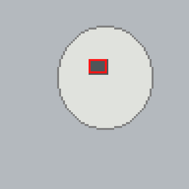

# Dental cavity detection with Faster R-CNN

**Near-infrared imaging · Object detection · PyTorch · COCO annotations**

This repository organizes the Faster R-CNN part of my dental cavity detection capstone project. The original implementation trained an object detector on near-infrared dental images, using COCO bounding-box annotations and evaluating detections on a separate test split.

The maintained code here covers dataset loading, Faster R-CNN training, inference, box matching metrics, and dataset audits. It also includes an archived copy of the original Python scripts so the research implementation remains visible.

**Research prototype only.** This is not a dental diagnostic device. There is no trained medical model or clinical validation included in this public repository.

## Project overview

- **Task:** Localize candidate cavity regions using bounding boxes in near-infrared dental images.
- **Model in the supplied archive:** Faster R-CNN with a ResNet-50 FPN backbone (Torchvision).
- **Annotation format:** COCO object detection, one foreground category (`cavity`).
- **Evaluation approach:** Detection overlap (IoU), precision, recall, F1, and COCO AP/AR in the archived scripts. The maintained lightweight evaluator reports thresholded precision, recall and F1, **not COCO mAP**.
- **Visualization:** The original archive includes a local Tkinter prediction viewer. The maintained project saves predictions to an image file instead.

The supplied archive did not include the trained Faster R-CNN checkpoint. As a result, the original model's predictions cannot be rerun directly. New training requires an appropriate image dataset.

## Synthetic demonstration



*This is a generated geometric illustration, not a dental image or a model prediction. Its only purpose is to test the data-loading and visualization code.*

The included `data/demo/` directory contains 20 small synthetic images across training, validation, and test splits. They are **not** substitutes for near-infrared imaging data; any model trained on them has no meaningful dental detection performance.

## Set up and run

Install Python 3.10 or newer. For PyTorch installation options, including CUDA builds, see [pytorch.org](https://pytorch.org/get-started/locally/).

```bash
python -m venv .venv
# Linux/macOS: source .venv/bin/activate
# Windows PowerShell: .venv\Scripts\Activate.ps1
pip install -r requirements.txt

# Verify the included COCO example.
python scripts/audit_dataset.py --data data/demo

# Train one epoch on the generated geometric demo (CPU may be slow).
python train.py --data data/demo --epochs 1 --batch-size 2 --device cpu

# Evaluate the saved checkpoint on the synthetic test split.
python evaluate.py --data data/demo --split test \
  --checkpoint checkpoints/fasterrcnn.pth

# Draw detections on one synthetic example.
python predict.py --image data/demo/test/synthetic_test_001.png \
  --checkpoint checkpoints/fasterrcnn.pth --output outputs/prediction.png
```

On Windows PowerShell, run each command on one line instead of using the `\` line continuation. The training command is for a **software smoke test**, not a medical experiment. One epoch on a tiny synthetic dataset may produce no detections and zero evaluation metrics, even when the code runs correctly.

To use a private COCO image dataset, put `train/`, `valid/`, and `test/` under your own data directory; each needs `_annotations.coco.json` and the corresponding image files. Then pass `--data /path/to/dataset` to `train.py` and `evaluate.py`. You may enable `--pretrained-backbone` when you have internet access to download the pretrained ResNet-50 weights. The default avoids downloading pretrained weights automatically.

To run the Python tests:

```bash
pip install -r requirements-dev.txt
python -m pytest -q
```

## What is in the repository?

```text
.
├── README.md
├── cavity_detection/
│   ├── data.py               # COCO parsing, box clipping, class labels
│   ├── model.py              # Faster R-CNN and safe checkpoint loading
│   └── evaluation.py         # Precision / recall / F1 at configurable IoU
├── train.py                  # Model training and checkpoint saving
├── evaluate.py               # Evaluate on a COCO validation/test split
├── predict.py                # Annotated-image inference
├── data/demo/                # Clearly marked synthetic examples
├── scripts/
│   ├── generate_demo.py
│   ├── audit_dataset.py
│   └── evaluate_archived_predictions.py
├── tests/                    # Unit tests for data and scoring behavior
├── docs/
│   ├── technical_review.md
│   ├── original_dataset_audit.json
│   └── synthetic_example.png
├── legacy/                   # Original capstone Python scripts, unchanged
├── requirements.txt
├── requirements-dev.txt
├── .gitignore
└── .github/workflows/tests.yml
```

## Original dataset audit

The original archive contained the following COCO-referenced subset:

| Split | Images | Labeled boxes | Distinct filename families |
| --- | ---: | ---: | ---: |
| Train | 603 | 1,065 | 201 |
| Validation | 61 | 120 | 61 |
| Test | 31 | 61 | 31 |

A separate archive audit found 707 additional image files **not referenced** by those COCO annotation files. The audit found no identical image bytes or matching augmentation filename families **among the referenced images across splits**. This does not rule out visually similar near-duplicates or patient-level overlap.

See [dataset audit](docs/original_dataset_audit.json) and [technical review](docs/technical_review.md) for details. The actual dental image dataset is not published here, pending confirmation of its original source, redistribution rights and any relevant privacy obligations.

## Evaluation and limitations

The maintained evaluator matches confidence-filtered predicted bounding boxes to ground truth of the same class with a configurable IoU threshold (default 0.5). It reports **micro-aggregated** precision, recall and F1, including false positives on images with no annotations. These metrics are different from COCO mean average precision (mAP).

The original scripts also had a COCO evaluation routine, but the checkpoint and full experiment provenance are not available in the uploaded archive. I therefore do not report an independently reproduced test AP, precision, recall or F1 for the historic model in this README.

This public version refactors data handling and evaluation for clearer reuse. It should not be assumed to reproduce the exact parameters or metrics of the historical capstone experiments.

## Research context

This project was developed as part of a capstone on deep learning for dental cavity detection using near-infrared imaging. The supplied files contain a Faster R-CNN implementation. Other detector architectures mentioned in the broader capstone are not included in this code archive, so this repository does not claim to reproduce their experiments.
